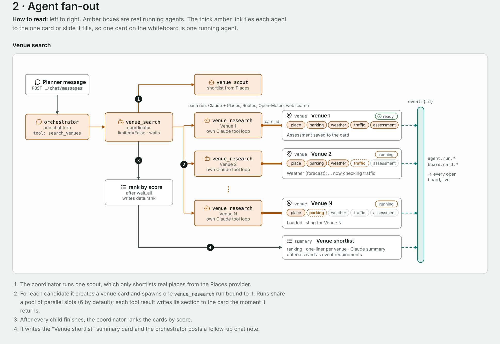
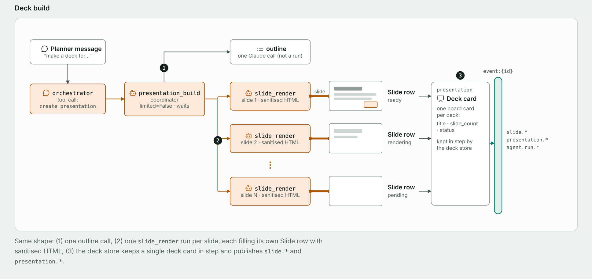
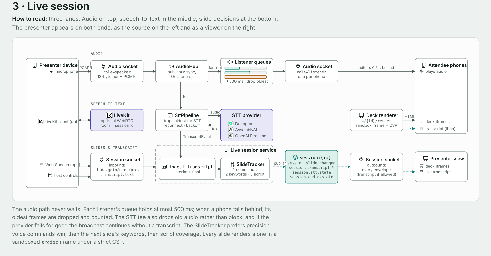

# Evently

AI-assisted event planning. A planner chats with an AI that spins up research agents to find and
vet venues (capacity, parking, weather, rush-hour traffic) and shows each one as a live card on a
whiteboard. The planner can generate a slide deck, present it with live transcription and
voice-driven slide changes, and let attendees' phones follow along and act as loudspeakers. Emails
and a Luma event page are drafted in chat and sent only after confirmation.

## Architecture

[](docs/architecture/Evently-Architecture-Map.pdf)

Every state change flows through the EventBus as a sequenced envelope, so the whiteboard, decks and
live session are projections of running agents rather than UI state with a backend bolted on.
Full map as a PDF: [docs/architecture/Evently-Architecture-Map.pdf](docs/architecture/Evently-Architecture-Map.pdf)
(interactive version: <https://claude.ai/artifact/PsmW2qY3YxtwmvSwBoowuM>). The other three views:

<details>
<summary><b>2 · Agent fan-out</b> — one venue search becomes a scout, N research agents (one per card) and a ranker; one deck request becomes an outline and N slide renderers</summary>




</details>

<details>
<summary><b>3 · Live session</b> — the presenter's microphone is fanned out to attendee phones and teed to speech-to-text, whose transcript drives the SlideTracker</summary>


</details>

<details>
<summary><b>4 · Platform &amp; integrations</b> — GitHub → CI → Sonar + Gitar; a single-replica API Deployment on Kubernetes with Postgres, Elasticsearch, Redis and OpenTelemetry → Dash0, watched by Radar; agent Jobs planned</summary>


</details>

```
frontend/       React + Vite planner app, presenter and attendee pages
backend/        FastAPI backend (Python 3.13) — see backend/docs
.github/        CI: ruff, pytest, SonarQube Cloud scan, container image to GHCR
.gitar/         Gitar review rules (architecture rules enforced on PRs)
```

## Run the backend locally

```bash
cd backend
brew install go-task            # once
task tools:install              # once: kind, helm, podman (+ a rootful podman machine)
task setup                      # .venv, dependencies, .env from .env.example
# fill in backend/.env (ANTHROPIC_API_KEY at minimum; see .env.example for the rest)
task dev                        # http://localhost:8000/docs
```

Without go-task:

```bash
cd backend
/opt/homebrew/bin/python3.13 -m venv .venv && .venv/bin/pip install -e ".[dev,otel,search]"
cp .env.example .env
.venv/bin/uvicorn app.main:app_factory --factory --reload --port 8000
```

`task compose:up` starts Postgres, Redis, Elasticsearch and an OpenTelemetry collector alongside the
API; `task k8s:up` creates a local kind cluster and deploys the dev overlay. Containers run on
**Podman** by default (`ENGINE=docker` switches to Docker). `task --list` shows everything.

Frontend (from `backend/`): `task fe:install` once, then `task dev:all` runs the API on :8000 and the
Vite app on http://localhost:5173 (it proxies `/api` and `/ws` to the API; no sign-in needed in dev).
`task fe:types` regenerates `frontend/src/api/schema.d.ts` from the API schema after backend changes.

## What is where

| Area | Code | Docs |
|---|---|---|
| Architecture and work split | `backend/app/` | `backend/docs/IMPLEMENTATION_PLAN.md` |
| Deploying (Docker, Compose, Kubernetes, Taskfile) | `backend/deploy/`, `backend/Taskfile.yml` | `backend/docs/DEPLOYMENT.md` |
| Observability (OpenTelemetry → Dash0) | `backend/app/observability/` | `backend/docs/OBSERVABILITY.md` |
| Search (Elasticsearch: venue memory, transcripts, chat, slides) | `backend/app/search/` | `backend/docs/SEARCH.md` |
| Live transcription providers | `backend/app/transcription/` | `backend/docs/TRANSCRIPTION.md` |

## Configuration

Everything is read from `backend/.env` (template: `backend/.env.example`). Features degrade
cleanly when a key is missing: chat, venue research and deck generation return `503` without
`ANTHROPIC_API_KEY`; venue search uses labelled sample data without a Google Maps key;
transcription falls back to the browser's Web Speech API without an STT key; email, Luma, search
and telemetry are off until configured.

The LLM is Claude by default. `LLM_PROVIDER=openai` (with `OPENAI_API_KEY`) moves every LLM call
to OpenAI; `LLM_PROVIDER_OVERRIDES` moves single features, e.g.
`LLM_PROVIDER_OVERRIDES=orchestrator=openai,presentations=openai` runs chat orchestration and deck
generation on OpenAI and leaves venue research on Claude. `.env.example` lists every purpose, and
`GET /api/v1/health` shows the resulting routing.

## Realtime protocol

Every state change is published as an envelope `{id, type, topic, seq, ts, data, trace_id}` and
forwarded unchanged over `WS /ws/events/{event_id}` (planner workspace), `GET /api/v1/events/{id}/stream`
(same, as SSE), `WS /ws/sessions/{session_id}` (live session) and binary audio over
`WS /ws/sessions/{session_id}/audio`. Event types are listed in `backend/app/realtime/events.py`.
Live-session lifecycle, slide and presence envelopes (`session.updated`, `session.slide.changed`,
`session.participant.joined/left`) are also published on the owning event's topic, so the planner
workspace sees them without joining the session; transcript and audio stay on the session topic.
The first-paint `GET /api/v1/events/{id}/snapshot` takes `?include=slides,chat,emails,luma`, and deck
render URLs accept `?token=` for iframes. `backend/docs/IMPLEMENTATION_PLAN.md` §4 has the details.
